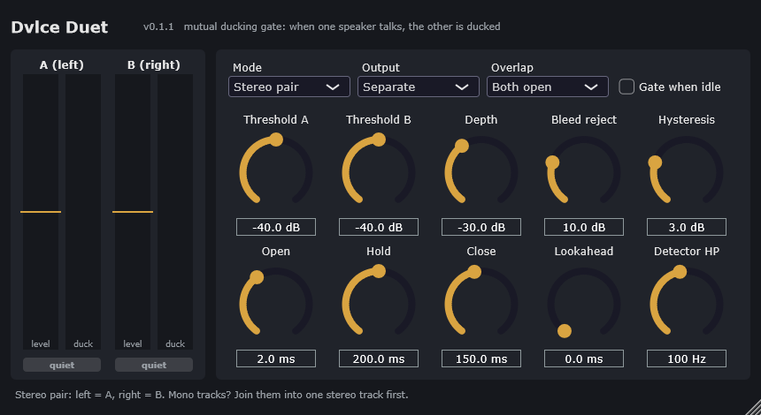

# Dvlce Duet

A mutual ducking gate for two speakers (podcasts, interviews, dialogue). When one person talks, the other
person's mic drops by a set depth. Mic bleed (the other voice leaking into a mic) is rejected, so the
quiet mic stays ducked even though it hears the talker.

Formats: VST3 + Standalone (Windows, macOS), AU (macOS). AAX for Pro Tools is not in the release yet (it needs the
AAX SDK and PACE signing: see Build).

## Install

Download the zip for your system from [Releases](https://github.com/toyuvalo/dvlce-duet/releases/latest).

- **Windows:** copy `Dvlce Duet.vst3` to `C:\Program Files\Common Files\VST3\`, then rescan plugins in your host.
- **macOS:** copy `Dvlce Duet.component` to `~/Library/Audio/Plug-Ins/Components/` and `Dvlce Duet.vst3` to
  `~/Library/Audio/Plug-Ins/VST3/`. Not notarised: if macOS blocks it, run
  `xattr -dr com.apple.quarantine "<path to the plugin>"` once.

## Two ways to connect the speakers

| Mode | What goes in | Use it in |
|---|---|---|
| **Stereo pair** | One stereo track: left = speaker A, right = speaker B | Every host. The only way in Audacity and Premiere (no sidechain there). |
| **Sidechain** | This track = speaker A, sidechain input = speaker B | FL Studio, Pro Tools, REAPER. One instance per speaker, each keyed from the other. |

**Output** (Stereo pair only): *Separate* keeps A left and B right. *Mixed* puts both gated voices on both
channels, so the result is a finished centred dialogue track.

## Per host

- **Audacity (3.2 or later)**: put A's mono track above B's. On the top track's menu choose
  *Make Stereo Track*. Select it, then *Effect > Dvlce Duet*. Afterwards *Split Stereo to Mono* gives the two
  gated tracks back, or use Output = Mixed for one finished track. The first time, Audacity asks to enable
  the new plugin (or: *Effect > Plugin Manager*, enable Dvlce Duet).
- **FL Studio**: put Duet on both speakers' mixer tracks, mode Sidechain. On A's track, right-click B's
  route arrow > *Sidechain to this track*, and the other way round. In the plugin wrapper, set the
  sidechain input to that track (Processing tab, *Sidechain* / input port).
- **Pro Tools**: AAX only. Insert Duet on both tracks, mode Sidechain, set each instance's *key input* to a
  bus carrying the other speaker. A mono key is supported.
- **Premiere Pro**: select both clips, *Merge Clips* (or use a stereo clip with A left, B right), set the
  merged clip's channels to stereo L/R, then add Duet as a clip effect with Output = Mixed.

## Controls

| Control | Meaning | Default |
|---|---|---|
| Threshold A / B | Detector level (RMS dBFS) above which that speaker counts as talking | -40 dB |
| Depth | How far the silent speaker drops. Full right = mute | -30 dB |
| Bleed reject | A speaker this far under the other (each against its threshold) is bleed, not speech | 10 dB |
| Hysteresis | Talking ends only this far under the threshold | 3 dB |
| Open / Close | Time to open / duck across the full depth (linear ramp in dB) | 2 / 150 ms |
| Hold | Talking state survives pauses between words this long | 200 ms |
| Lookahead | Delays the audio so the gate opens before the first word. Adds this much latency | 0 ms |
| Detector HP | High-pass on the detector only (rumble, plosives) | 100 Hz |
| Overlap | Both talking: *Both open* passes the crosstalk, *Louder wins* ducks the quieter | Both open |
| Gate when idle | Nobody talking: duck both (a normal gate on top) | off |

Set each threshold just above that mic's noise floor, and under its quietest speech. Watch the meters:
the gold line is the threshold, the red bar is how far the speaker is ducked.

## Build

Windows: `build-win.bat` (VS 2022 Build Tools, CMake, Ninja). macOS: `./build-mac.sh` (universal). JUCE 8.0.13 is fetched. Optional env:
`JUCE_DIR`, `BUILD_DIR`, `AAX_SDK`.

AAX: get the AAX SDK from the Avid Developer Program, then `set AAX_SDK=<folder>` and build. An unsigned
AAX loads only in Pro Tools Developer. Retail Pro Tools needs the plugin signed with PACE `wraptool`
(a PACE/iLok developer account).

## Tests

- `dvlce_duet_core_tests` (built by `build-win.bat`): the engine on synthetic speakers, 18 checks.
- `DvlceDuetSidechainTest`: Sidechain mode on the real processor, mono key.
- `bench/plugin_test.py <inner .vst3 binary>`: the built VST3 through pedalboard, Stereo pair mode.
- pluginval strictness 10: pass.

## Licence

**Free for non-commercial use. If you make money with it, you need a licence from the author first.**

The code is under the [PolyForm Noncommercial License 1.0.0](LICENSE).

- You may use, change and share it for any non-commercial purpose: personal podcasts and projects, hobby,
  study, research, education, charities and public bodies.
- Paid work needs a commercial licence first: editing a podcast or video for a client, a monetised show,
  use inside a company, or selling or bundling the plugin or code derived from it. See [`COMMERCIAL.md`](COMMERCIAL.md).

This is source-available software, not OSI "open source". The `LICENSE` text governs; this section is a summary.

### JUCE licence

The plugin links [JUCE 8](https://juce.com), which has its own licence: AGPLv3 or a JUCE licence
(the free Starter tier, or Indie/Pro). The released builds are made under the author's JUCE licence.
If you build and share your own binaries, JUCE's terms apply to you as well.

Required Notice: Copyright 2026 Yuval Olsha (https://github.com/toyuvalo)
